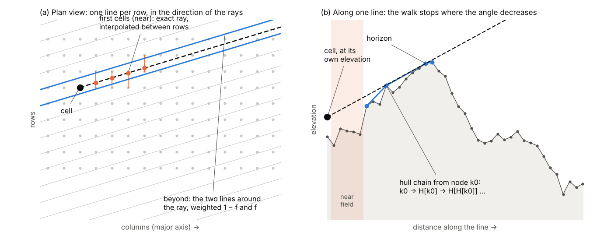

# Features

`TopoPyScale` (TPS) has a number of features to customize your downscaling. This pages is an attempt to describe all features currently implemented.

## Spatial vs. Point downscaling

TPS can be used to downscaled in two modes. The simplest case is to use the library to downscale weather timeseries at a list of points. This list of points id specified in a `.csv` file using coordinate system of the same projection (*i.e.* EPSG code). At minimum each line of the `.csv` file should contain:

```text
name,x,y
```

Using the setting spatial in `toposub` will lead you using the clustering method decribed in more details here below. 

## Fetching ERA5 data from CDS

ERA5 can also be fetched from NCAR GDEX instead of the CDS (`climate.era5.data_repository: gdex`), see [Dataset Sources](04_datasetSources.md#from-ncar-gdex).

As of now, TPS includes a class to implementing all the functionalities in dealing with the ERA5 data independent from `Topoclass`. This makes the process, now very long, of fetching data more flexible and robuts. The class eith inherits the config from `Topoclass`, or can be directly pointed towards the `config.yml` file.

```python
from TopoPyScale import fetch_era5 as fe 
from TopoPyScale import topoclass as tc 

config_file = 'config.yml'
mp = tc.Topoclass(config_file)
era = fe.FetchERA5(config=mp.config)
era.go_fetch()
```

The class integrate a number of options to make the downloading more flexible. For instance only download Surface Level data, with a given set of variables.

```python
from TopoPyScale import fetch_era5 as fe 
era = fe.FetchERA5(config='config.yml')

varoi = ['geopotential_at_surface',
			'surface_thermal_radiation_downwards',
            'surface_solar_radiation_downwards',
            'surface_pressure',
            'total_precipitation', 
            '2m_temperature'
        ]

era.varoi_surf = varoi
era.go_fetch()
```

This way it is possible to use routines for TPS project but not only.


## Convert ERA5 to Zarr

As explained in the (Datasets)[04_datasetSources.md], TPS relies on ERA5 data. In the future more datasets could be included. The minimum data required are at pressure levels `t,p,q,u,v`, and the surface level:
```
- 'geopotential_at_surface'
- '2m_dewpoint_temperature'
- 'surface_thermal_radiation_downwards',
- 'surface_solar_radiation_downwards','surface_pressure',
- 'total_precipitation'
- '2m_temperature'
- 'toa_incident_solar_radiation',
- 'friction_velocity'
- 'instantaneous_moisture_flux'
- 'instantaneous_surface_sensible_heat_flux'
```

TPS requests daily files of the ERA5 pressure levels and surface level, and concatenates them with `cdo` into yearly files (`inputs/climate/yearly/`). Downscaling then reads ERA5 from a zarr store, `inputs/climate/ERA5.zarr`, built from the yearly files the first time `mp.downscale_climate()` runs (and rebuilt if it does not cover the project period). The conversion opens one pair of PLEV/SURF files at a time and appends it to the store. It can also be run explicitly:

```python
from TopoPyScale import fetch_era5 as fe

fe.netcdf_to_zarr(path_to_netcdfs='inputs/climate/yearly',
                  zarrout='inputs/climate/ERA5.zarr',
                  plev_name='PLEV_*.nc',
                  surf_name='SURF_*.nc',
                  time_chunk=720)
```

The store holds `z, t, q, u, v, r` on pressure levels and `z_surf, sp, t2m, d2m, tp, ssrd, strd` at the surface, as float32 compressed with Blosc. The function also harmonizes files downloaded from the new CDS (`valid_time`, `pressure_level`, `expver`).

## Parallelization

TPS uses parallelization for a number of steps: threads to manage download requests to the CDS server, processes over directions for the sky view factor, threads over blocks of points for the horizons, multiple cores for clustering, and threads over blocks of points for the downscaling (`project.parallelization.setting.multicore.CPU_cores`).

## Solar geometry

`solar_geom.get_solar_geom()` computes, for every point and time step:

- the solar zenith, azimuth and elevation angles at the centre of the radiation accumulation window (`t − 30 min` for ERA5), with the NREL Solar Position Algorithm of pvlib (`nrel_numpy`, about 0.0003° accuracy). The time-dependent part of the algorithm is computed once for all points; only the location-dependent part is evaluated per point, as arrays. For 2400 points and one year of hourly data this takes about 12 s, instead of about 65 s point by point;
- the top-of-atmosphere irradiance on a horizontal surface `SWtoa`, averaged over the accumulation window with `toposcale.solar_substeps` sub-steps (default 6). It uses the solar constant `toposcale.solar_constant` (default 1361 W m⁻²) scaled by the Earth–Sun distance, consistently with the accumulated ERA5 fluxes it is compared to (clearness index). Averaging over the window matters at sunrise and sunset, where the value at the window centre differs from the hourly mean by up to about 35 W m⁻².

`ds_solar.nc` is stored as float32. A file computed by an older version prints a warning when loaded; delete it to recompute it.


## Slope, aspect and sky view factor

`mp.compute_dem_param()` computes the elevation, slope, aspect and sky view factor of every DEM cell and saves them to `outputs/ds_param.nc`. An existing `ds_param.nc` is loaded as is: delete it to recompute it (files computed with topocalc by earlier versions differ by about 0.003 in svf, see below).

**Slope and aspect** come from the 3 × 3 neighbourhood of each cell (Horn's finite differences, `topo_param.gradient_d8()`, the same code as topocalc's). The aspect is in radians, 0 = south, +π/2 = east, the convention of the solar azimuth.

**Sky view factor.** The svf is the part of the sky hemisphere seen by the ground surface, each direction weighted by the cosine of its angle to the normal of the surface. It is 1 on flat open ground and (1 + cos S)/2 on a plane of slope S with nothing above it. It scales the diffuse shortwave and the longwave from the sky; 1 − svf weights the longwave emitted by the surrounding terrain (`toposcale.LW_terrain_contribution`). `topo_param.sky_view_factor()` integrates it from the horizon angle H in 72 directions, every 5° (Dozier and Frew, 1990, eq. 7b), keeping the positive part of the integrand:

svf = 1/(2π) ∫ [cos S sin²H' + sin S cos(φ − A) (H' − sin H' cos H')] dφ, with H' = 90° − H the horizon angle from the zenith, S the slope and A the aspect.

**Horizons of every cell: line sweep.** One azimuth at a time, `topo_param.horizon_sweep()` computes the horizon of all cells of the DEM:

1. The grid axis closest to the direction is the major axis. Rays advance one column per step (columns stand for the major axis here) and drift by t rows per column, |t| ≤ 1.
2. Parallel straight lines in the direction of the rays cross the grid, one per row. At each column, the elevation of a line is interpolated linearly between the two rows it passes between.
3. Along each line, from its end back to its start, each node gets a pointer to the node ahead seen at the steepest angle. Following the pointers from any node walks along the upper convex hull of the line ahead of it (Dozier and Frew, 1990). From an observer, the elevation angle to the hull nodes rises to the horizon, then decreases, so the walk stops at the first decrease. The pointers of a line cost a number of steps proportional to its length. All lines are processed together as arrays.
4. The ray of each cell passes between two of these lines, at a distance f from one and 1 − f from the other (in rows). Over its first 32 cells (`near`), the ray is traced exactly, interpolating the DEM between rows at each column. Beyond, the horizon is the steepest angle from the elevation of the cell to the hull of each of the two lines, weighted by 1 − f and f. The horizon of the cell is the higher of the two parts.

{ width="900" }

Along the grid axes and diagonals the lines pass through the cell centres, and the result is exact. In other directions, distant terrain changes little from one line to the next, so the two lines around a ray give its horizon well. Near terrain changes much faster from one line to the next, which is why the first 32 cells are traced along the ray itself. Without them (`near=0`), horizons are wrong by more than 3° for 5% of the cells of the Davos example.

On the Davos example (SRTM 30 m, 747 × 500 cells), compared with exact straight rays from every cell in the 72 directions:

| | svf difference: median | 99th percentile | maximum |
|---|---|---|---|
| line sweep (`near` = 32) | 0.00001 | 0.0001 | 0.001 |
| topocalc (earlier versions) | 0.003 | 0.016 | 0.046 |

topocalc follows lines of sight shaped as staircases, which step at the same columns for all cells. The cells just before a step read their nearest terrain from the adjacent row, which leaves streaks in its horizon and svf maps for directions a few degrees off the grid axes. The straight lines of the sweep have no steps.

Each direction takes about 0.5 s on the Davos DEM (373,500 cells), so the svf takes about 45 s on one core. Most of this time goes to the near part, so the cost grows with the number of cells times `near`. The directions are shared between `project.parallelization.setting.multicore.CPU_cores` processes (23 s with 2), and summed in order: the svf does not depend on the number of processes. No-data cells (NaN) never form a horizon. Their svf is NaN, as is that of their neighbours, which have no slope. Earth curvature is ignored (about 0.1° for terrain 20 km away).

For maps of horizons, `topo_param.compute_horizon(dem_file, azimuth_inc=30)` runs the same sweep for each direction and writes `outputs/da_horizon_grid.nc`, with dimensions (`azimuth`, `y`, `x`).


## Horizons

`mp.compute_horizon()` computes the horizon angle of each point in the directions `dem.horizon_increments` degrees apart (the centres of the bins: -175, -165, ..., 175 for 10°; 0 = south, 90 = east, ±180 = north). The downscaling sets the direct beam to zero when the sun is below the horizon of the nearest direction. The horizons are saved to `outputs/da_horizon.nc`, with dimensions (`azimuth`, `point_name`), and as the columns `hori_azi_<azimuth>` of `df_centroids`.

From each point, `topo_param.horizon_rays()` follows a straight ray in each direction, one cell at a time along the major grid axis, interpolating the DEM bilinearly. The observer is on the DEM surface at the exact position of the point, not at the centre of the nearest cell. The horizon is the steepest elevation angle to the terrain along the ray, or 0 if no terrain is higher than the point. A ray stops at the edge of the DEM, or as soon as no terrain further away could be steeper than the horizon already found: the highest elevation of the DEM seen from that distance is below it. This shortcut does not change the result. No-data cells never form a horizon. Earth curvature is ignored.

For the 50 centroids of the Davos example (747 × 500 cells), this takes 0.15 s and writes 24 kB. Each point and direction costs about 10 µs on that DEM. With `sampling.method: grid`, every cell is a point: about 2 minutes for the 373,500 cells of Davos on one core. Blocks of points run in `project.parallelization.setting.multicore.CPU_cores` threads.

An existing `da_horizon.nc` is loaded if it holds the same points (names and positions), and recomputed otherwise, including files computed on the full DEM grid by earlier versions.


## Surface-effect correction of air temperature

TopoSCALE takes the air temperature and humidity of a point from the pressure levels: free-atmosphere air, without the inversions, cold-air pools and daily cycle that ERA5 resolves at its own surface. With `toposcale.surface_effect.method: redcapp` or `dreamit`, the downscaling adds back a terrain-weighted share of the ERA5 surface signal ΔT = t2m − T_pl(z_ERA5 surface):

T = T_pl(z_point) + w ΔT + β(t), and Td = Td_pl(z_point) + w ΔTd, capped at T.

w = 0 gives the plain TopoSCALE values; w = 1 transfers the whole grid-surface difference. The longwave is then computed from the corrected temperature and humidity (`lw_consistent`). The weight of each point comes from its terrain, computed once on `context_dem`, which must cover the points plus the window:

| Method | Weight | Terrain | Published coefficients |
| --- | --- | --- | --- |
| `redcapp` ([Cao et al. 2017](https://doi.org/10.5194/gmd-10-2905-2017)) | w = α [H (1 − S) + S] + β V (1 − S), S = exp(−R / γ) | hypsometric position H and relief R in a 30 km wide circle; V = MRVBF / 8 | Swiss Alps: α 0.61, β 1.56, γ 465 m |
| `dreamit` ([Pozsgay et al. 2026](https://doi.org/10.5194/gmd-19-7197-2026)) | w = α_intercept + exp(α_slope h) − 1, plus β(t) = β_amp cos(2π(t − t*)) + β_bias | hypsometric position h within 50 km | ERA5, Yukon: α_intercept 0.449, α_slope 0.732, β_amp 0.918, t* 0.958, β_bias 1.181 K |

The hypsometric position is the fraction of the DEM cells in the window that are higher than the point: 0 on the highest summit, 1 at the bottom of the lowest valley. The indices and `w_surf` are added to `df_centroids`. DReaMIT defines ΔT against a lapse rate fitted above the inversion; TopoPyScale uses its own pressure-level interpolation, as REDCAPP does.

Published coefficients may not transfer: at Davos (January 2020), the Yukon DReaMIT coefficients over-correct the Weissfluhjoch crest. `TopoPyScale.surface_calib` fits them for a new region from station records:

```python
from TopoPyScale import surface_calib as sc, surface_effect as se
# 1. downscale the stations as a points project with surface_effect: {method: none, diagnostics: true}
data = sc.pair(mp.downscaled_pts.load(), {name: sc.read_meteoswiss(file) for name, file in station_files.items()})
indices = {r: se.terrain_indices(df_stations, 'glo90.tif', r, epsg=32632).set_index(df_stations.point_name)
           for r in [5, 15, 30, 50]}
res = sc.calibrate('dreamit', data, indices, fit_beta='bias')   # pooled fit, cross-validation, bootstrap
sc.save_coefficients(res, 'surface_coeffs.yml')                  # then surface_effect.coefficients: surface_coeffs.yml
```

`calibrate` fits w per station (diagnostic), then the coefficients by pooled least squares over all stations and hours, keeps the window radius with the lowest cross-validated error (leave one station out, or contiguous time blocks with fewer than 3 stations), and gives moving-block bootstrap intervals. `fit_beta` is `none`, `bias` (regional offset) or `seasonal` (DReaMIT β(t), needs a year of data).


## Clustering

Clustering offer a number of possibilities. First, any DEM can by segmented by clustering (k-means) using a list of features. These features can be topographic or anything which can be labeled to the pixel level (e.g. watershed, glaciated land, etc.). The clustering will return a list of groups of pixels that fall within the same "cluster". The method implemented is K-means from [Scikit-learn](https://sklearn.org/stable/getting_started.html). To speed up the processing, TPS will use the routine `minibatch_kmean()` to spread the computational load on multiple core. 

### Clustering features

In the config file, the line `clustering_features: {'x':1, 'y':1, 'elevation':1, 'slope':1, 'aspect_cos':1, 'aspect_sin':1, 'svf':1}` will define which variables are used to perform the clustering. A variable must be defined in `ds_param` to be used. Each feature are associated to a weight (default 1), but can be modulated higher or lower than one to diminish or enhance the effect of the selected variable. 
The value in `clustering_features` is a multiplier applied during the feature scaling prior to the K-means clustering.
This option allows to apply feature importance relative to the others. **This multiplier must be $>0$.** 
It may be useful for instance to emphasize the role of elevation in case of sharp terrain or any other variable.  


With the example below, the elevation as a factor of 4 relative to other features. 
```python
clustering_features: {'x':1, 'y':1, 'elevation':4, 'slope':1, 'aspect_cos':1, 'aspect_sin':1, 'svf':1}
```

If you add new features specific to your project, be aware that all features are standardize using the `scikit-learn` function `StandardScaler()`. Other types of scaler not yet available.

It is recommanded to keep the bare minimum variable: `x,y,elevation`.

### Searching optimum number of clusters

There are no clear cut method to decide the ideal number of clusters. However there exists a number of technics to find a compromise between a sufficiently fine segmentation and the lowest number of clusters (less computation). These methods are implemented `Topo_sub`. It includes a method to search for the optimal number of clusters: `search_optimum_number_of_clusters()`. This may be used in the following manner:

```python
from TopoPyScale import topoclass as tc
import numpy as np

config_file = './config.yml'
mp = tc.Topoclass(config_file)
mp.compute_dem_param()
df = mp.search_optimum_number_of_clusters(cluster_range=np.arange(100,1000,50),plot=False)
```

This will compute the scores Within-Cluster-Sum-of-Squares (WCSS) Davies-Bouldin, Calinski-Harabasz, and the RMSE between the original DEM elevation and the clustered DEM elevation. Any of these may be used to decide of an appropriate number of clusters  

### Masking

While the input DEM is a raster file and have rectangular boundings, TPS allows to mask part of the DEM. The mask should be a GeoTiff of the same grid (same boundings) as the mains DEM. Pixels categorized as `1` will be considered for downscaling, the one as `0` will be ignored. This should be specified into the config file with the following: `clustering_mask: clustering/catchment_mask.tif` within the section `toposub`.

### Groups

The clustering can be defined in subgroups. This may be usefull for instance when one wants to split a watershed in different section (i.g. glacier, alpine, fan, lake, *etc.*). This can be done by creating a raster file of the same size and bounds as the DEM with an arbitrary set of integers. Each integers will define a group. The path to the raster file must be indicated in the config file as part of the `toposub` section as follow: `clustering_groups: clustering/groups.tif`.

Now one can set relative number of clusters per group. Default, it maintain cluster density per area homogenous across groups.

To trigger the option.
1 in config.yml:
add clustering_group_weights: 'inputs/dem/gw.csv' in toposub
2. create a csv file, here called gw.csv
```
group,weight
8,0.8
4,0.2
```
This will use 20% of clusters to group 4 and 80% for group 8.

## FSM integration

As part of TPS, we integrated a number of functions to interact with the snow model **FSM**. 

## Realtime

**@Joel can you write smthg?**
