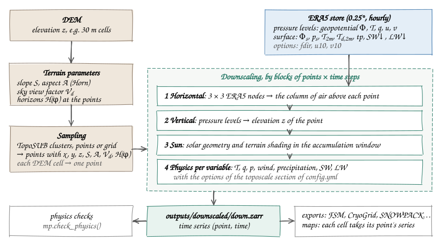
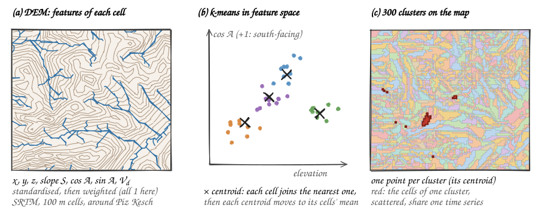
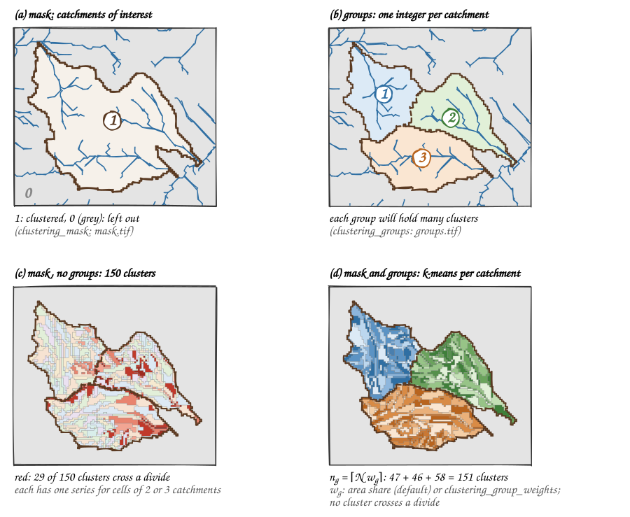
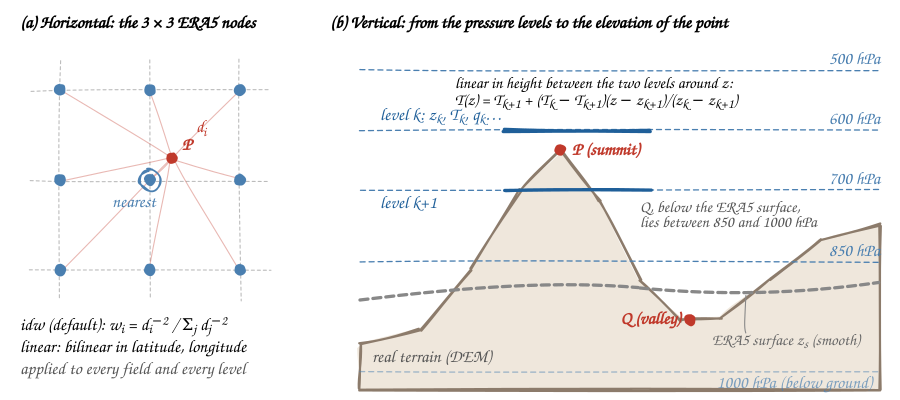
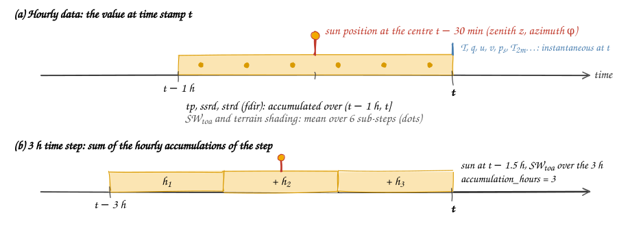

# How TopoPyScale works

TopoPyScale turns a coarse climate reanalysis, ERA5 at 0.25° (about 28 km between nodes in latitude), into hourly time series for points that represent the terrain of a DEM. These points are the centroids of terrain clusters (TopoSUB [@fiddes2012]), a list of chosen points, or every cell of the DEM. The physics is TopoSCALE [@fiddes2014]:

1. take the column of ERA5 air above each point;
2. read it at the elevation of the point;
3. correct radiation and precipitation for the terrain around the point.

This page follows the chain from the DEM and the reanalysis to the time series. [Variables and options](12_variables.md) gives the equations of each variable and of each option.



*Figure 1. The processing chain. The DEM gives terrain parameters and the points; ERA5 gives the atmosphere. The downscaling runs on blocks of points and time steps, and writes one store of time series.*

## Notation

| Symbol | Meaning | Unit |
|---|---|---|
| $z$ | elevation of the point | m |
| $S$ | slope | rad |
| $A$ | aspect: 0 = south, $+\pi/2$ = east, $\pm\pi$ = north (the convention of the solar azimuth) | rad |
| $V_d$ | sky view factor | – |
| $H(\varphi)$ | horizon angle (elevation of the skyline) in the direction $\varphi$ | rad |
| $z_s$, $p_s$ | elevation and pressure of the ERA5 surface at the point (interpolated), $z_s = \Phi_s / g$ | m, Pa |
| $t$, $\Delta t$ | time stamp (UTC) and time step (1, 3 or 6 h) | h |
| $a$ | hours accumulated in the ERA5 fluxes at $t$ (store attribute `accumulation_hours`) | h |
| $g$, $R_d$, $\varepsilon$, $\sigma$ | 9.81 m s⁻², 287.05 J kg⁻¹ K⁻¹, 0.622, 5.67 × 10⁻⁸ W m⁻² K⁻⁴ | |

## 1. Terrain parameters

**Slope and aspect.** `mp.compute_dem_param()` uses Horn's finite differences on the 3 × 3 neighbourhood of each cell (`topo_param.gradient_d8`). With the neighbours

| | | |
|:-:|:-:|:-:|
| $a$ | $b$ | $c$ |
| $d$ | $e$ | $f$ |
| $g$ | $h$ | $i$ |

$$
\frac{\partial z}{\partial x} = \frac{(c + 2f + i) - (a + 2d + g)}{8\,\Delta x}, \qquad
\frac{\partial z}{\partial y} = \frac{(g + 2h + i) - (a + 2b + c)}{8\,\Delta y}, \qquad
S = \arctan\lVert\nabla z\rVert .
$$

The aspect is the direction the slope faces, that is, the direction of steepest descent.

**Horizons.** The horizon angle in the direction $\varphi$ is the steepest elevation angle to the terrain along a straight ray from the point:

$$
H(\varphi) = \max\left(0,\ \max_{d>0} \arctan\frac{z(d) - z_0}{d}\right).
$$

`mp.compute_horizon()` follows one ray per direction, every `dem.horizon_increments` degrees (36 directions at 10°), from the exact position of each point. It interpolates the DEM bilinearly along the ray (see [Horizons](07_features.md#horizons)).

**Sky view factor** [@dozier1990]. $V_d$ is the share of the radiation of an isotropic sky that a surface receives. It counts both the sky hidden by the terrain and the sky behind the tilt of the slope:

$$
V_d = \frac{1}{2\pi}\int_0^{2\pi}\left[\cos S\,\sin^2 H' + \sin S\,\cos(\varphi - A)\,(H' - \sin H'\cos H')\right]d\varphi, \qquad H' = \frac{\pi}{2} - H(\varphi).
$$

Only the positive part of the integrand is kept. $V_d = 1$ on flat open ground and $(1 + \cos S)/2$ on an unobstructed plane of slope $S$. The rest, $1 - V_d$, is the share of the view filled by terrain: the configuration factor of the terrain, used for the longwave it emits and the shortwave it reflects.

## 2. Sampling the terrain

**TopoSUB clusters** (`sampling.method: toposub`). Each cell of the DEM is a vector of features: by default $x$, $y$, $z$, $S$, $\cos A$, $\sin A$ and $V_d$ (`sampling.toposub.clustering_features`).

- Each feature is standardised (zero mean, unit variance), then multiplied by its importance weight.
- k-means splits the cells into $n$ clusters (`n_clusters`). It minimises the spread of the features within the clusters: $\sum_c \sum_{i \in c} \lVert \mathbf{f}_i - \mathbf{m}_c \rVert^2$, with $\mathbf{f}_i$ the features of cell $i$ and $\mathbf{m}_c$ the centre of cluster $c$.
- Each cluster becomes one point:
    - its clustering features are the cluster centre transformed back to physical units, the mean of its cells for k-means;
    - its other parameters are means over its cells, and its aspect is the circular mean $\operatorname{atan2}(\overline{\sin A}, \overline{\cos A})$.
- Every cell keeps the label of its cluster. A map of any downscaled variable gives each cell the series of its cluster.



*Figure 2. TopoSUB on the SRTM DEM around Piz Kesch (Switzerland), at 100 m. (a) Each cell is a vector of features. (b) k-means gathers cells that are close in feature space. (c) The 300 clusters on the map. A cluster is a class of terrain, not a region: the cells of the red cluster lie in several places, and they all get the series computed for its centre.*

**Fewer points than cells.** A project typically has tens to about a thousand clusters, far fewer than the cells of the DEM. The series of a cluster is computed for the parameters of its centre, a typical cell of the cluster. It is not an average of the series of its cells.

**Mask** (`sampling.toposub.clustering_mask`). A raster of 0 and 1 on the DEM grid: only the cells at 1 are clustered, for instance the catchments of interest in a larger DEM (Figure 3a). The other cells, and the nodata cells of the DEM, get no cluster (`point_name` = `-9999`).

**Groups of clusters** (`sampling.toposub.clustering_groups`). A raster of integers on the DEM grid: catchments, land cover, glaciers, *etc.* (Figure 3b). Groups do not change what a cluster is, they bound it: a group is much larger than a cluster and holds many of them. Without groups, a cluster gathers similar cells from anywhere in the mask, so its cells can lie in several catchments (Figure 3c). With groups, each group is clustered on its own:

- Group $g$ gets $n_g = \lceil N w_g \rceil$ clusters, where $N$ is `n_clusters`. By default $w_g$ is the share of the clustered cells that lie in the group: $N$ is shared out in proportion to the areas, and the density of points is the same everywhere. A CSV file (`sampling.toposub.clustering_group_weights`, columns `group,weight`, weights summing to 1) sets other shares, for instance more points on a glacier. Rounding up gives up to one extra cluster per group: $\sum_g n_g \geq N$.
- The features of a group are standardised with the mean and the standard deviation of that group. A group with a narrow range of elevation is still split along elevation.
- The labels of group $g$ follow those of the previous groups: clusters $0 \ldots n_1 - 1$ belong to the first group, $n_1 \ldots n_1 + n_2 - 1$ to the second, and so on. No cluster crosses a group boundary (Figure 3d), and the map of groups is saved as `cluster_group` in `ds_param.nc`.



*Figure 3. Mask and groups on the DEM of Figure 2. (a) The mask keeps three catchments of interest. (b) The groups raster gives each catchment its own integer. (c) With the mask only, $N = 150$: 29 clusters (red) have cells in two or three catchments. (d) With the groups, k-means runs in each catchment: 47, 46 and 58 clusters for area shares of 31, 30 and 39 %, and none crosses a divide.*

**Values per catchment.** Since each cluster lies in one group, a catchment average is a weighted sum over its own clusters. The weight of cluster $c$ is its share of the cells of the catchment, $n_{c}/\sum_{c' \in g} n_{c'}$ (cells have the same area):

```python
import xarray as xr

cells = mp.toposub.ds_param[['point_name', 'cluster_group']].to_dataframe()
cells = cells[cells.point_name != '-9999']                  # cells outside the mask
share = cells.groupby('cluster_group').point_name.value_counts(normalize=True)
tp_basin = {}
for g, w in share.groupby(level='cluster_group'):
    w = xr.DataArray(w.values, coords={'point_name': w.index.get_level_values('point_name')})
    tp_basin[g] = (mp.downscaled_pts.tp.sel(point_name=w.point_name) * w).sum('point_name')
```

`tp_basin[g]` is the mean precipitation of catchment $g$ at each time step. Multiplied by the area of the catchment, it gives a volume.

**Points and grid.** With `sampling.method: points`, the parameters come from the cell of each given point (`nearest`), or are interpolated (`idw`, `linear`). With `grid`, every cell is a point.

## 3. From the ERA5 grid to the point



*Figure 4. (a) Horizontal interpolation from the 3 × 3 ERA5 nodes around the point. (b) Vertical interpolation between the two pressure levels around the elevation of the point.*

**Horizontal.** Each point takes the 3 × 3 ERA5 nodes around its nearest node. With `toposcale.interpolation_method: idw` (default), the weights decrease with the square of the distance $d_i$, measured in the projection of the DEM:

$$
X_P = \sum_{i=1}^{9} w_i X_i, \qquad w_i = \frac{d_i^{-2}}{\sum_j d_j^{-2}} .
$$

A point on a node takes the value of the node. With `linear`, the weights are bilinear in latitude and longitude.

The same weights apply to every field, at every pressure level and every time step. So the point sees a column of ERA5 air above it (geopotential, $T$, $q$, $u$, $v$ on each level), and the ERA5 surface below it ($z_s$, $p_s$, $T_{2m}$, $T_{d,2m}$, fluxes).

**Vertical.** The geopotential height of each level, $z_k = \Phi_k / g$, changes with time. At each time step, the two levels around the elevation of the point are $k$ (above) and $k+1$ (below). Temperature, humidity and wind are linear in height between them:

$$
X(z) = X_{k+1} + (X_k - X_{k+1})\,\frac{z - z_{k+1}}{z_k - z_{k+1}}, \qquad X \in \{T, q, u, v\}.
$$

The pressure follows the hypsometric equation from the level above, with the mean temperature of the layer:

$$
p(z) = p_k \exp\left(-\frac{g\,(z - z_k)}{R_d\,\bar{T}}\right), \qquad \bar{T} = \tfrac{1}{2}\left(T_k + T(z)\right).
$$

**Points below the ERA5 surface.** ECMWF extrapolates the pressure levels below its own smooth ground, so a valley point below $z_s$ usually still lies between two levels.

**Points outside the levels.**

- Below the lowest level downloaded, a point takes the values of that level, and its pressure follows the same hypsometric equation.
- Above the highest level, the downscaling stops with an error: download higher levels.

The ERA5 surface of the point, $z_s$, is used three times:

- for the elevation difference of the precipitation factor;
- for the surface signal of the surface-effect correction;
- for the surface pressure $p_s$ in Beer's law for the shortwave.

## 4. Time: instantaneous values and accumulations



*Figure 5. (a) Instantaneous fields at the time stamp $t$; fluxes accumulated over the hour before it, with the sun taken at the centre of that hour. (b) At 3 h time steps, the store holds the sum of the three hourly accumulations of each step.*

**Instantaneous and accumulated fields.**

- The ERA5 analysis fields are instantaneous at $t$: pressure levels, $T_{2m}$, $T_{d,2m}$, $p_s$, $u_{10}$, $v_{10}$.
- The fluxes are accumulated over the hours before $t$: precipitation `tp`, shortwave `ssrd`, longwave `strd`, direct shortwave `fdir`.

**Hours accumulated per time step.**

- In hourly data the fluxes cover $(t - 1\,\mathrm{h}, t]$.
- At 3 h or 6 h time steps, the stores fetched by TopoPyScale hold the sums over the whole step, so $a = \Delta t$ (see [Features](07_features.md#fetching-era5-data-from-cds)). An hourly store downscaled at 3 h or 6 h is summed the same way.

A flux in W m⁻² is the mean over the window, $F = X / (3600\,a)$. The precipitation of a step is $\mathrm{tp}\,\Delta t / a$.

**Solar geometry.** The position of the sun comes from the NREL Solar Position Algorithm [@reda2004], evaluated at the centre of the accumulation window, $t - a/2$:

- the zenith angle $z_\odot$ and the azimuth $\varphi_\odot$ (0 = south, positive towards east, as the aspect);
- $\mu_0 = \max(\cos z_\odot, 0)$.

The top-of-atmosphere irradiance on a horizontal surface is averaged over $n$ sub-steps (`toposcale.solar_substeps`, default 6), at the centres of $n$ equal parts of the window:

$$
SW_\mathrm{toa} = \frac{S_0}{R^2}\,\frac{1}{n}\sum_{k=1}^{n} \max(\cos z_k, 0),
$$

with $S_0 = 1361$ W m⁻² (`toposcale.solar_constant`) and $R$ the Earth–Sun distance in astronomical units. Averaging over the window matters most in the hours of sunrise and sunset, when the sun crosses the horizon within the window.

**Terrain shading within the window.** The sun can clear or drop behind a ridge during the hour, and the direct beam is scaled by the sunlit part of the window. At each sub-step $k$, the sun has elevation $e_k$ and azimuth $\varphi_k$, and lights the slope with $\cos i_k$ (Section [Shortwave](12_variables.md#shortwave-radiation)). The shaded fraction weights each sub-step by the beam it brings to the slope:

$$
s = 1 - \frac{\sum_k w_k\,\mathbb{1}\left[e_k > H(\varphi_k)\right]}{\sum_k w_k}, \qquad
w_k = \begin{cases} \max(\cos i_k, 0) & e_k > 0 \\ 0 & \text{otherwise.} \end{cases}
$$

Details of the shading:

- $H(\varphi_k)$ is the horizon of the nearest direction.
- Only terrain shading counts: sub-steps with the sun below the astronomical horizon get no weight.
- When no sub-step has the sun above the horizon and facing the slope ($\sum_k w_k = 0$), the horizon is tested once, at the centre of the window.
- The sub-steps use a cheaper geocentric sun position, without the parallax (below 0.003°) and the atmospheric refraction.

## 5. Computing by blocks

The downscaling (`topo_scale_zarr.ClimateDownscaler`) works on blocks of points (`toposcale.point_block`, default 100) and blocks of time steps (`toposcale.time_block`, default one year). For each block it:

- reads only the ERA5 nodes around its points;
- computes the solar geometry of its points and time steps;
- applies sections 3 and 4 and the physics of [Variables and options](12_variables.md);
- writes its part of `outputs/downscaled/down.zarr`.

Blocks of points run in parallel threads (`CPU_cores`). The memory depends on the size of a block, not on the number of points or the length of the period. The [physics checks](09_physics_checks.md) read the outputs by blocks of time steps in the same way.
