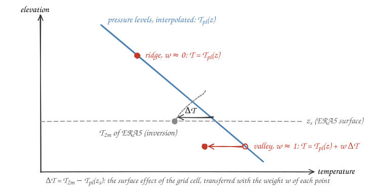
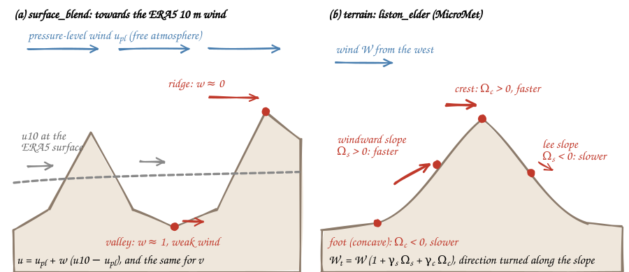
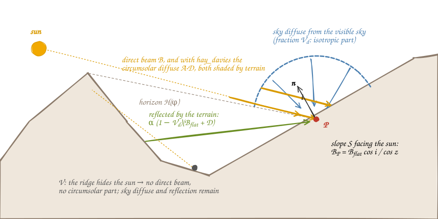
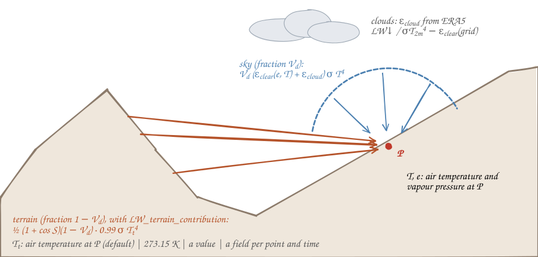

# Variables and options

This page gives the equations of each downscaled variable, first with the default settings, then with each option. [How it works](11_how_it_works.md) explains the steps the variables share: the terrain parameters, the horizontal and vertical interpolation, the time conventions and the solar geometry. It also defines the notation used here.

| Variable | Unit | Description |
|---|---|---|
| `t` | K | air temperature |
| `q` | kg kg⁻¹ | specific humidity |
| `vp`, `w` | Pa, kg kg⁻¹ | vapour pressure, mixing ratio |
| `p` | Pa | air pressure |
| `u`, `v` | m s⁻¹ | wind towards east and north |
| `ws`, `wd` | m s⁻¹, rad | wind speed, direction the wind blows from (clockwise from north) |
| `tp` | mm per time step | precipitation |
| `precip_lapse_rate` | – | elevation factor applied to `tp` |
| `SW`, `SW_direct`, `SW_diffuse` | W m⁻² | shortwave on the slope: total, direct beam, diffuse (sky and terrain) |
| `SW_terrain` | W m⁻² | shortwave reflected by the terrain, part of `SW_diffuse` (option) |
| `cos_illumination` | – | cosine of the angle between the sun and the normal of the slope |
| `LW` | W m⁻² | longwave |
| `cse` | – | clear-sky emissivity at the point |

The radiative fluxes and the precipitation cover the accumulation window ending at the time stamp. The other variables are instantaneous.

## Air temperature

**Default.** The temperature of the pressure levels at the elevation of the point, $T = T_{pl}(z)$ (vertical interpolation). Its lapse rate is that of the ERA5 atmosphere between the two levels, so it changes with the weather. Pressure levels describe the free atmosphere at the altitude of the point. A valley point therefore misses the inversions, cold-air pools and daily cycle of the air near the ground.

*Figure 6. Surface-effect correction. ERA5 resolves the near-surface air of its own smooth ground: $T_{2m}$ differs from the pressure-level temperature at the same elevation by $\Delta T$. Each point receives a share $w$ of this signal according to its terrain.*

**Option `toposcale.surface_effect`** (method `redcapp` or `dreamit`, see [Features](07_features.md#surface-effect-correction-of-air-temperature)). The signal of the ERA5 surface,

$$
\Delta T = T_{2m} - T_{pl}(z_s), \qquad \Delta T_d = T_{d,2m} - T_{d,pl}(z_s),
$$

is added with a weight $w$ that depends on the terrain of the point:

$$
T = T_{pl}(z) + w\,\Delta T + \delta(t).
$$

The weights use the hypsometric position $h$: the fraction of the DEM cells within a window around the point that are higher than the point (0 on the highest summit, 1 at the bottom of the lowest valley).

- REDCAPP [@cao2017], window of 15 km radius:

    $$
    w = \alpha\left[h(1 - s_r) + s_r\right] + \beta\,\frac{\mathrm{MRVBF}}{8}\,(1 - s_r), \qquad s_r = e^{-R/\gamma}.
    $$

    Here $R$ is the elevation range in the window and MRVBF the multi-resolution valley bottom flatness index. The published coefficients are $\alpha = 0.61$, $\beta = 1.56$, $\gamma = 465$ m (Swiss Alps), and $\delta = 0$.

- DReaMIT [@pozsgay2026], window of 50 km radius:

    $$
    w = \alpha_0 + e^{\alpha_1 h} - 1, \qquad \delta(t) = \delta_a \cos\left(2\pi(\tau - \tau^*)\right) + \delta_b,
    $$

    with $\tau$ the fraction of the year. The published coefficients are $\alpha_0 = 0.449$, $\alpha_1 = 0.732$, $\delta_a = 0.918$ K, $\tau^* = 0.958$, $\delta_b = 1.181$ K (Yukon and Northwest Territories).

- `surface_calib` fits the coefficients of either method to stations of a new region.

## Humidity

**Default.** The specific humidity of the pressure levels at the point, $q = q_{pl}(z)$. The vapour pressure and the mixing ratio follow from it, with the formulas of `meteo_util`:

$$
r = \tfrac{1}{2}\left(1 - \sqrt{1 - 4q}\right), \qquad e = \tfrac{p}{2}\left(\sqrt{1 + 4r/\varepsilon} - 1\right).
$$

These match $r = q/(1-q)$ and $e = p\,r/(\varepsilon + r)$ within 0.1 %.

**Option `surface_effect` with `dewpoint: true`** (default of the option). The dew point is corrected like the temperature, then capped at the corrected temperature:

$$
T_d = \min\left(T_{d,pl}(z) + w\,\Delta T_d,\ T\right).
$$

The specific humidity comes back from the dew point with the Magnus formula,

$$
e_d = 610.94\,\exp\frac{17.625\,T_{d,c}}{243.04 + T_{d,c}}, \qquad q = \frac{r_d}{1 + r_d}, \qquad r_d = \frac{\varepsilon\,e_d}{p - e_d},
$$

with $T_{d,c}$ in °C. With `lw_consistent: true` (default of the option), the longwave uses the corrected temperature and humidity.

## Pressure

The hypsometric equation from the pressure level above the point (see [How it works](11_how_it_works.md#3-from-the-era5-grid-to-the-point)). It follows the elevation exactly, and the weather through the temperature and the height of the level.

## Wind

**Default.** The wind of the pressure levels at the elevation of the point, $(u, v) = (u_{pl}, v_{pl})(z)$:

$$
W = \sqrt{u^2 + v^2}, \qquad \theta = \operatorname{atan2}(-u, -v) \bmod 2\pi .
$$

This is free-atmosphere wind, without the drag of the surface. It is close to the observations on exposed summits, and too strong in valleys: three times the measured mean at Davos in January 2020.

*Figure 7. (a) Blending with the ERA5 10 m wind. (b) Terrain factors of MicroMet.*

**Option `toposcale.wind_downscaling.surface_blend`.** The wind moves towards the ERA5 10 m wind interpolated to the point:

$$
u = u_{pl} + w\,(u_{10} - u_{pl}), \qquad v = v_{pl} + w\,(v_{10} - v_{pl}).
$$

The weight $w$ is a constant in $[0, 1]$, or `surface_effect`: the weight of the temperature correction clipped to $[0, 1]$. Valleys then get the surface wind of ERA5, and ridges keep the free-atmosphere wind. Using the temperature weight for the wind is an assumption of TopoPyScale, not a published method.

**Option `wind_downscaling.terrain: liston_elder`** [@listonMicroMet2006]. It applies after the blending, and uses two terrain terms scaled to $[-0.5, 0.5]$ over the DEM:

- the slope in the direction the wind comes from:

    $$
    \Omega_s = \frac{S\cos(\theta - \xi)}{2\,S_{max}}, \qquad \xi = \pi - A .
    $$

    Here $\xi$ is the azimuth the slope faces, clockwise from north, and $S_{max}$ the steepest slope of the DEM.

- the curvature over the length $\eta$ (`curvature_length`, default 500 m):

    $$
    \Omega_c^* = \frac{1}{4}\sum_{(m,\,n)} \frac{z - \tfrac{1}{2}(z_m + z_n)}{2\,d_{mn}}, \qquad \Omega_c = \frac{\Omega_c^*}{2\max_\mathrm{DEM}\lvert\Omega_c^*\rvert}.
    $$

    The sum runs over the pairs of opposite neighbours (W, E), (S, N), (SW, NE) and (NW, SE), at the distance $d_{mn} = \eta$ along the axes and $\sqrt{2}\,\eta$ on the diagonals. The curvature of a cluster is the mean over its cells.

The speed and the direction become

$$
W_t = W\,(1 + \gamma_s\,\Omega_s + \gamma_c\,\Omega_c), \qquad \theta_t = \theta - \tfrac{1}{2}\,\Omega_s \sin\left(2(\xi - \theta)\right),
$$

with $\gamma_s = 0.58$ and $\gamma_c = 0.42$ (`slope_weight`, `curvature_weight`). Windward slopes and crests are faster, lee slopes and hollows slower. The wind turns towards the direction along the slope [@ryan1977]. The factor stays within about ±30 %, so it does not remove the excess of valley wind: the blending is the option for that.

## Precipitation

**Default.** The ERA5 precipitation of the window, interpolated horizontally, over the time step:

$$
\mathrm{tp} = f \cdot 1000\,\mathrm{tp}_{ERA5}\,\frac{\Delta t}{a} \quad [\mathrm{mm}], \qquad f = 1 .
$$

**Option `climate.precip_lapse_rate: true`.** The elevation factor of MicroMet [@listonMicroMet2006], with $\Delta z = z - z_s$ in km:

$$
f = \frac{1 + c_m\,\Delta z}{1 - c_m\,\Delta z}, \qquad \lvert c_m\,\Delta z\rvert \le \frac{f_{max} - 1}{f_{max} + 1} .
$$

The bound keeps $f$ within $[1/f_{max}, f_{max}]$ (`precip_lapse_rate_max_factor`, default 5). Without it, $f$ diverges at $\Delta z \approx 2.9$ km in winter. The monthly coefficients $c_m$ [km⁻¹] come from the Northern Hemisphere:

| Jan–Mar | Apr | May | Jun–Sep | Oct | Nov | Dec |
|---|---|---|---|---|---|---|
| 0.35 | 0.30 | 0.25 | 0.20 | 0.25 | 0.30 | 0.35 |

South of the equator, the month is shifted by six: January takes the July coefficient.

**Rain and snow.** `down.zarr` holds the total precipitation. The exporters split it with `meteo_util.partition_snow`:

- `continuous` (default): the snow fraction is 1 below 272.15 K, 0 above 274.15 K, and linear in between.
- `jennings2018_bivariate`: the probability of snow $p = 1 / \left(1 + e^{-10.04 + 1.41\,T_c + 0.09\,RH}\right)$ [@jennings2018], with $T_c$ in °C and $RH$ in %. Each time step is all snow or all rain, drawn with that probability.
- `jennings2018_trivariate`: the same with $-12.80 + 1.41\,T_c + 0.09\,RH + 0.03\,p_{kPa}$.

## Shortwave radiation

*Figure 8. Shortwave at a point P on a slope facing the sun: direct beam on the slope, diffuse from the part of the sky the point sees, and radiation reflected by the opposite slope. The ridge hides the sun from point V.*

The shortwave is computed in six steps.

**1. The grid flux.** $SW_{grid} = \max(\mathrm{ssrd}, 0) / (3600\,a)$ and the clearness index $k_t = SW_{grid} / SW_\mathrm{toa}$, clipped to $[0, 1]$, while the sun is up.

**2. Direct and diffuse at the grid** (`toposcale.direct_diffuse`).

- `empirical` (default), from the clearness index [@ruizarias2010]:

    $$
    k_d = 0.952 - 1.041\,e^{-e^{\,2.300 - 4.702\,k_t}},
    $$

    $$
    D = k_d\,SW_{grid}, \qquad B = \min(SW_{grid} - D,\ SW_\mathrm{toa}).
    $$

- `era5`, from the direct radiation of the ERA5 radiation scheme on a horizontal surface:

    $$
    B = \min\left(\max\left(\frac{\mathrm{fdir}}{3600\,a}, 0\right),\ SW_{grid},\ SW_\mathrm{toa}\right), \qquad D = SW_{grid} - B.
    $$

**3. Direct beam at the elevation of the point.** The grid column has the transmissivity $\tau = B / SW_\mathrm{toa}$ for its surface pressure $p_s$. Beer's law with the same extinction gives the column above the point, of pressure $p$:

$$
B_{flat} = SW_\mathrm{toa}\,\tau^{\,p/p_s} = SW_\mathrm{toa}\exp\left(-\frac{k\,p}{g\,\mu_0}\right), \qquad k = \frac{g\,\mu_0}{p_s}\ln\frac{SW_\mathrm{toa}}{B}.
$$

A summit above the ERA5 surface ($p < p_s$) gets more direct beam, and a valley below it less. The diffuse part keeps the value of the grid.

**4. Direct beam on the slope.** The cosine of the illumination angle is

$$
\cos i = \cos z_\odot \cos S + \sin z_\odot \sin S \cos(\varphi_\odot - A),
$$

and the beam on the slope is

$$
B_P = B_{flat}\,\frac{\max(\cos i, 0)}{\cos z_\odot}\,(1 - s),
$$

with $s$ the shaded fraction of the window (see [How it works](11_how_it_works.md#4-time-instantaneous-values-and-accumulations)).

**5. Diffuse from the sky** (`toposcale.diffuse_model`).

- `isotropic` (default): the sky radiates equally in all directions, and the point sees a share $V_d$ of it:

    $$
    D_P = V_d\,D.
    $$

- `hay_davies` [@hay1980]: a share of the diffuse equal to the anisotropy index $A_i = B / SW_\mathrm{toa}$ comes from around the sun. It is projected on the slope like the beam and lost in terrain shadow:

    $$
    D_P = D\left[(1 - A_i)\,V_d + A_i\,R_b\,(1 - s)\right], \qquad R_b = \frac{\max(\cos i, 0)}{\max(\cos z_\odot, \cos 85^\circ)} .
    $$

    On flat open ground the two models agree. Under clear skies Hay–Davies brightens slopes facing the sun and darkens the others. Under overcast skies ($A_i \to 0$) it is isotropic.

**6. Reflection by the surrounding terrain** (`toposcale.SW_terrain_albedo` $= \alpha$, default 0, off). The terrain fills the share $1 - V_d$ of the view of the point. It reflects the global radiation of a level surface at the point:

$$
SW_{terrain} = \alpha\,(1 - V_d)\,(B_{flat} + D).
$$

The albedo can also be given per point and time step, for example the snow albedo of a snow model run on the points.

**Totals.**

$$
SW_{direct} = B_P, \qquad SW_{diffuse} = D_P + SW_{terrain},
$$

$$
SW = SW_{direct} + SW_{diffuse}.
$$

## Longwave radiation

*Figure 9. Longwave at a point: from the visible sky, with the clouds of ERA5, and from the surrounding terrain.*

**1. Clouds, from the grid.** ERA5 gives the all-sky emissivity of its surface. Removing the clear-sky part leaves the contribution of the clouds:

$$
\varepsilon_{cloud} = \frac{\mathrm{strd} / (3600\,a)}{\sigma\,T_{2m}^4} - \varepsilon_{clear}(e_{2m}, T_{2m}),
$$

with $e_{2m}$ the vapour pressure of $T_{d,2m}$ at $p_s$. The clouds are assumed the same above the point.

**2. Clear sky, at the point.** The emissivity has the form of Konzelmann et al. [@konzelmann1994], with the coefficients of TopoSCALE:

$$
\varepsilon_{clear}(e, T) = 0.23 + 0.43\left(\frac{e}{T}\right)^{1/5.7},
$$

with $e$ in Pa and $T$ in K. It is evaluated with the vapour pressure and temperature of the point; this is the output `cse`.

**3. Sky part.** The point sees a share $V_d$ of the sky:

$$
LW = V_d\,\left(\varepsilon_{clear}(e, T) + \varepsilon_{cloud}\right)\sigma T^4 .
$$

**4. Terrain part** (`toposcale.LW_terrain_contribution: True`). The surrounding terrain emits as a body of emissivity 0.99 at the temperature $T_t$:

$$
LW = V_d\,\left(\varepsilon_{clear} + \varepsilon_{cloud}\right)\sigma T^4 + \tfrac{1}{2}(1 + \cos S)(1 - V_d)\,0.99\,\sigma T_t^4 .
$$

The weight $\tfrac{1}{2}(1 + \cos S)(1 - V_d)$ is the one of TopoSCALE. The reflected shortwave above uses the configuration factor $1 - V_d$ alone. The temperature $T_t$ (`toposcale.LW_terrain_temperature`) is one of:

- `air` (default): the air temperature of the point;
- `fixed`: 273.15 K, the value of version 1.0. It suits melting snow, but overestimates the longwave of cold terrain by about 60 W m⁻² × the weight at −15 °C;
- a value in K;
- a field per point and time step, for example the surface temperature of a snow model run on the points.

## Options at a glance

| Variable | Key | Values (default first) |
|---|---|---|
| all | `toposcale.interpolation_method` | `idw`, `linear` |
| `t`, `q` | `toposcale.surface_effect.method` | `none`, `redcapp`, `dreamit` |
| `q` | `toposcale.surface_effect.dewpoint` | `true`, `false` |
| `LW` | `toposcale.surface_effect.lw_consistent` | `true`, `false` |
| `u`, `v`, `ws`, `wd` | `toposcale.wind_downscaling.surface_blend` | `0`, a weight in [0, 1], `surface_effect` |
| `u`, `v`, `ws`, `wd` | `toposcale.wind_downscaling.terrain` | `none`, `liston_elder` |
| `tp` | `climate.precip_lapse_rate` | `false`, `true` |
| `tp` | `climate.precip_lapse_rate_max_factor` | `5`, a value > 1 |
| `SW*` | `toposcale.direct_diffuse` | `empirical`, `era5` |
| `SW*` | `toposcale.diffuse_model` | `isotropic`, `hay_davies` |
| `SW*` | `toposcale.SW_terrain_albedo` | `0`, an albedo |
| `SW*` | `toposcale.solar_substeps`, `toposcale.solar_constant` | `6`, `1361` |
| `LW` | `toposcale.LW_terrain_contribution` | `false`, `true` |
| `LW` | `toposcale.LW_terrain_temperature` | `air`, `fixed`, a temperature in K |
| all fluxes | `climate.<source>.accumulation_window` | from the store, or a duration |
